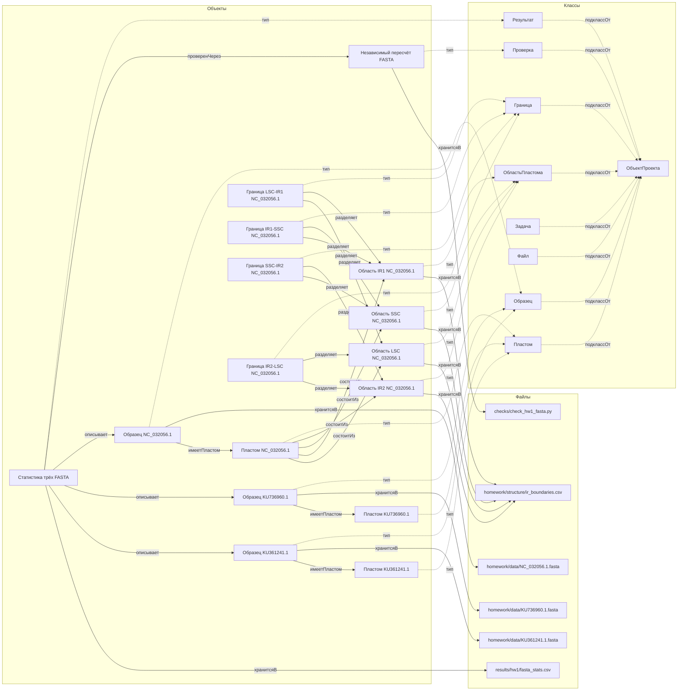

# Граф проекта — строение пластомов Taraxacum

Mermaid-схема узлов и связей графа проекта (AGENTS.md, раздел 8). Классы — из `ontology.yaml`; объекты — заметки в `notes/`; файлы — ссылки от корня.

